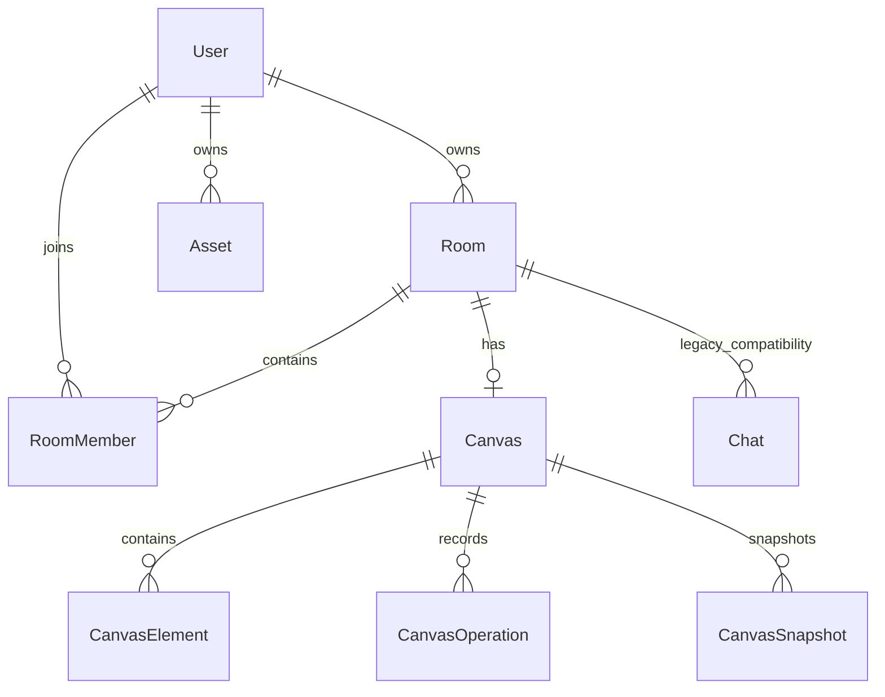

# 🎨 SketchWiz – AI-Powered Collaborative Canvas

SketchWiz is a real-time, AI-enhanced collaborative canvas built using cutting-edge technologies. It allows users to **draw**, **write math/physics problems**, and get **instant AI assistance** — whether it's solving equations or enhancing their sketches. Think of it as an AI version of Excalidraw powered by Google Gemini AI, WebSockets, and a powerful room-based architecture.

---

# 📽️ Demo

[](https://youtu.be/UU-s-GS0FT8)

---

## 🚀 Features

- 🔁 **Real-Time Collaboration**
  Join or create rooms using unique room names and collaborate with others. All drawings and interactions are **instantly synced** across all clients in the room using WebSockets.

- ✏️ **Infinite Canvas**
  A seamless, Excalidraw-style infinite canvas for freehand drawing, writing, and more.

- 🧠 **AI Assistance (Google Gemini)**

  - Solve **math** and **physics** problems drawn or written on the canvas.
  - Improve rough sketches with the help of AI-driven enhancements.

- 🏠 **Room-Based Architecture**

  - Create, join, or delete uniquely named rooms.
  - Each room stores its own canvas state and persists data, allowing users to pick up where they left off.

- 💾 **Persistent Drawing Storage**
  All drawings within a room are saved using PostgreSQL + Prisma, ensuring no data is lost when users leave or refresh.

---

## 🛠️ Tech Stack

### 🧩 Monorepo

- **Turborepo** – For organizing frontend, backend, and shared modules efficiently.

### 🎨 Frontend

- **Next.js** – React framework for SSR and performance
- **Tailwind CSS** – Utility-first styling
- **Framer Motion** – Smooth animations and transitions
- **WebSocket Client** – Real-time updates
- **Google Gemini API** – AI assistance and drawing understanding

### 🧠 Backend

- **Node.js** + **Express** – Scalable backend with REST & WebSocket handling
- **WebSockets (Socket.IO)** – Real-time room-based communication
- **Prisma ORM** – Type-safe database queries
- **PostgreSQL** – Persistent storage for canvas and room data

---

## 🔗 How It Works

1. **Create/Join Room:**
   Navigate to the app, enter a room name to create or join an existing one.

2. **Collaborate in Real-Time:**
   All participants see the canvas updates live.

3. **Draw or Write Equations:**
   Write problems directly on the canvas — Gemini AI will solve them or suggest improvements.

4. **Enhance Drawings:**
   Rough sketches? Let AI enhance them with a single click.

5. **Data Persistence:**
   Drawings remain saved in the room, accessible anytime.

---

## 📂 Folder Structure (Turborepo)

```
/apps
  /web        - Next.js frontend
  /server     - Node.js + Express backend

/packages
  /ui         - Shared UI components
  /config     - Shared config & types
```

---

## 🧪 Setup & Development

### Prerequisites

- Node.js (18+)
- PostgreSQL instance
- Gemini API Key

### 1. Clone the Repo

```bash
git clone https://github.com/your-username/sketchwiz.git
cd sketchwiz
```

### 2. Install Dependencies

```bash
npm install
```

### 3. Setup Environment Variables

Create `.env` files in `apps/server` and `apps/web` with:

```env
# Common
DATABASE_URL=postgresql://<username>:<password>@<host>:<port>/<db>

# Server
PORT=5000
GEMINI_API_KEY=your_api_key

# Web
NEXT_PUBLIC_API_URL=http://localhost:5000
```

### 4. Start Development

```bash
# In root
npm run dev
```

---

## 📸 Screenshots (Optional)

_Add visuals of canvas, AI solutions, and real-time collab here_

---

## 📌 Roadmap

- ✅ Drawing & writing on infinite canvas
- ✅ Real-time WebSocket sync
- ✅ AI-powered equation solving
- ✅ AI-powered sketch enhancement
- ✅ Persistent room data storage
- ⏳ Authentication & private rooms
- ⏳ Export canvas to image/PDF
- ⏳ Voice-to-math input

---

## Backend and API Reference

This section documents the backend implemented in `apps/server` and the realtime service in `apps/websocket`. Both are separate Node.js processes. They use Railway's `PORT` when set; local defaults are `5000` for HTTP and `8000` for WebSockets.

### Services and shared packages

- `apps/server/src/app.ts` creates the independently testable Express application. `src/index.ts` validates environment variables, connects to PostgreSQL, starts listening, and handles shutdown.
- `apps/server/src/modules/` contains authentication, room, and AI routes; shared error handling is in `src/middleware/`.
- `apps/websocket/src/server.ts` creates the WebSocket listener. Authentication, room membership, message parsing, persistence, and broadcasting are in separate modules.
- `packages/db` owns the canonical Prisma schema and migrations and exports one Prisma client singleton per service process. Prisma 7 uses the PostgreSQL driver adapter.
- `packages/common` provides Zod request and message schemas shared by both backend services.
- `packages/backend` validates service-specific environment variables and provides the structured logger.

### Environment variables

Set these on the service that uses them:

| Variable                                              | Used by                           | Purpose                                                                                |
| ----------------------------------------------------- | --------------------------------- | -------------------------------------------------------------------------------------- |
| `DATABASE_URL`                                        | HTTP server and WebSocket service | PostgreSQL connection string used by Prisma.                                           |
| `JWT_SECRET`                                          | HTTP server and WebSocket service | Signs and verifies authentication tokens. Both services must use the same value.       |
| `GEMINI_API_KEY`                                      | HTTP server                       | Authenticates Gemini API calls.                                                        |
| `PORT`                                                | Each deployed service             | Railway-provided port; defaults to `5000` (HTTP) or `8000` (WebSocket).                |
| `HOST`                                                | Each service                      | Listen host; defaults to `0.0.0.0`.                                                    |
| `CORS_ORIGINS`                                        | HTTP server                       | Comma-separated trusted browser origins; wildcard is accepted only outside production. |
| `AI_RATE_LIMIT` / `AI_RATE_WINDOW_MS`                 | HTTP server                       | Per-user AI request limit; defaults to 10 requests per 60 seconds.                     |
| `AI_MAX_CONCURRENT_PER_USER`                          | HTTP server                       | Maximum simultaneous AI requests per user; defaults to 2.                              |
| `WS_MAX_PAYLOAD_BYTES`                                | WebSocket service                 | Maximum WebSocket message size; defaults to 20 MiB.                                    |
| `WS_MESSAGE_RATE_LIMIT` / `WS_MESSAGE_RATE_WINDOW_MS` | WebSocket service                 | Per-user message ceiling; defaults to 500 messages per 10 seconds.                     |
| `NODE_ENV`                                            | Each service                      | `development`, `test`, or `production`; defaults to `development`.                     |

The web app also needs `NEXT_PUBLIC_BACKEND_URL` and `NEXT_PUBLIC_WS_URL` at build time; those are frontend settings, not server secrets. Set `CORS_ORIGINS` to the deployed frontend origin in production.

### Authentication

`POST /api/signin` returns a JWT on success. Send that token as either a raw `Authorization` value or as a Bearer token on protected HTTP endpoints, for example:

```http
Authorization: eyJhbGciOi...
```

The WebSocket client passes the same token as the `token` query parameter. New tokens use HS256 and expire after seven days. Signed tokens from the previous implementation are accepted for up to seven days from their issue time; expired, malformed, tampered, or invalid-identity tokens are rejected. The same `JWT_SECRET` must be configured for both backend services.

### HTTP endpoints

All routes are mounted at the root path shown below. JSON routes expect `Content-Type: application/json` unless otherwise noted.

#### `GET /api/ping`

Health check; no authentication or body required.

- `200`: plain text `pong`.

#### `POST /api/signup`

Creates a user. No authentication required.

Request JSON:

```json
{
  "email": "person@example.com",
  "username": "artist123",
  "name": "Example Artist",
  "password": "at-least-8-characters",
  "photo": "https://example.com/avatar.png"
}
```

`photo` is optional. The Zod schema requires a valid email, username and name of 3–30 characters, and a password of at least 8 characters. The password is hashed with bcrypt using 12 salt rounds before storage. The API does not return the created user.

- `201`: `{ "message": "User created successfully" }`
- `400`: invalid input, with Zod details in `errors`.
- `409`: duplicate email or username (as detected by the current error-message check).
- `500`: other database or server error.

#### `POST /api/signin`

Authenticates an existing user. No authentication required.

Request JSON:

```json
{ "email": "person@example.com", "password": "at-least-8-characters" }
```

The API validates input, looks up the user by email, compares the password with bcrypt, and signs a seven-day JWT containing the numeric user ID using `JWT_SECRET`. Sign-in and sign-up share a per-IP limit of 20 attempts per minute.

- `200`: `{ "message": "Signin successful", "token": "..." }`
- `400`: invalid input, with Zod details in `errors`.
- `401`: unknown email or incorrect password; both return `Invalid credentials`.
- `500`: unexpected database or server error.

#### `POST /api/room` (protected)

Creates a room owned by the authenticated user. The request body is `{ "roomName": "my-room" }`; room names must be 3–30 characters. The authenticated user ID becomes `adminId`; an OWNER membership and empty canvas are created with the room.

- `200`: `{ "message": "Joined room", "room": { ... } }` (the implementation creates a room despite the message saying “Joined”).
- `400`: invalid room name.
- `403`: duplicate room slug.
- `401`: missing, invalid, or expired token.

#### `GET /api/rooms` (protected)

Lists rooms owned by or joined by the authenticated user.

#### Room access and membership (protected)

Rooms have `OWNER`, `EDITOR`, and `VIEWER` memberships. Owners can change visibility, add existing users by ID as editors/viewers, remove non-owner members, clear a room, and delete a room. Editors can read and draw. Viewers can read and receive room updates but cannot submit drawing mutations. Private room lookups return `404` for nonmembers so room existence is not revealed.

New rooms are public to authenticated SketchWiz users for compatibility with the current share-by-slug client flow. The first authenticated request to a public room's slug creates an editor membership; no anonymous room access is granted. Owners can make a room private with:

```http
PATCH /api/room/:roomId/visibility
Content-Type: application/json
Authorization: Bearer <token>

{ "visibility": "PRIVATE" }
```

Add an existing user with `POST /api/room/:roomId/members` and `{ "userId": 123, "role": "VIEWER" }`. Remove a non-owner with `DELETE /api/room/:roomId/members/:userId`. The existing frontend contract remains unchanged; room IDs/slugs that the old API exposed to every signed-in user are now protected by membership and visibility.

#### AI routes (protected)

`POST /api/analyze/ai` returns `{ "analysisResult": [...] }`; `POST /api/improve/ai` returns generated image bytes with an image content type. Both require an authenticated user and a PNG, JPEG, or WebP `image` upload up to 10 MiB. If a multipart `roomId` is supplied, it must be a room member. Calls have a per-user request limit, concurrency ceiling, and 60-second provider timeout. Current frontend calls omit `roomId`, so these calls are authenticated and rate-limited but cannot be associated with a specific room.

Lists rooms whose `adminId` matches the authenticated user. This is not a list of every room the user may have joined.

- `200`: `{ "rooms": [ ... ] }`
- `500`: database errors return a safe generic error response.
- `401`: missing, invalid, or expired token.

#### `GET /api/room/:roomId` (protected)

Returns up to 2,000 persisted chat rows in ID order for the numeric room ID as `{ "messages": [ ... ] }`. The caller must be an owner, editor, or viewer member.

- `200`: `{ "messages": [ ... ] }`
- `500`: database errors return a safe generic error response.
- `401`: missing, invalid, or expired token.

#### `GET /api/room/slug/:slug` (protected)

Looks up one room by its slug and returns `{ "room": room }`. Existing members can access private rooms; authenticated users can join public rooms as editors.

- `200`: `{ "room": room }`.
- `404`: room does not exist or is private to another user.
- `500`: database errors return a safe generic error response.
- `401`: missing, invalid, or expired token.

#### `DELETE /api/room/delete/:roomId` (protected)

Deletes all chat rows for a room and then deletes the room in a Prisma transaction. Only an owner can delete it.

- `200`: success message and deleted `room` object.
- `500`: deletion or database error.
- `401`: missing, invalid, or expired token.
- `403` or `404`: caller is not the room owner or the room is private to another user.

#### `DELETE /api/room/delete/content/:roomId` (protected)

Deletes chat, canvas element, operation, and snapshot rows for the specified room, leaving the room in place and incrementing its revision. Only an owner can clear it.

- `200`: `{ "message": "Content deleted successfully.", "response": { ...deleteMany count... } }`
- `500`: deletion or database error.
- `401`: missing, invalid, or expired token.
- `403` or `404`: caller is not the room owner or the room is private to another user.

#### `POST /api/analyze/ai` (protected multipart image upload)

Accepts `multipart/form-data` with a valid PNG, JPEG, or WebP `image` file (maximum 10 MiB). The route sends it to Gemini for visual interpretation, then returns `{ "analysisResult": [...] }`. It uses `gemini-3.8-flash`, parses the model response as JSON, and returns a cleaned response if parsing fails. A supplied `roomId` must belong to the authenticated user.

- `200`: `{ "analysisResult": [...] }`.
- `400`: `{ "error": "No image provided" }`.
- `401`: missing or invalid token.
- `429`: per-user AI request limit exceeded.
- `502`: sanitized provider failure.

#### `POST /api/improve/ai` (protected multipart image upload)

Accepts `multipart/form-data` with a valid PNG, JPEG, or WebP `image` file (maximum 10 MiB). It asks Gemini to generate a more detailed prompt, then uses `gemini-3.1-flash-image` for an enhanced sketch. On success it returns image bytes with an image content type. A supplied `roomId` must belong to the authenticated user.

- `200`: PNG image bytes.
- `400`: `{ "error": "No image provided" }`.
- `401`: missing or invalid token.
- `429`: per-user AI request or concurrency limit exceeded.
- `502`: sanitized provider failure.

### WebSocket protocol

Connect to `ws://<host>:8000/?token=<JWT>` locally, or `wss://.../?token=<JWT>` in production. The server verifies the token during connection. Invalid or missing tokens are closed. Messages are JSON objects validated against the shared schema.

Client message types:

| Type         | Required fields     | Behavior                                                                                                                                                                                                                      |
| ------------ | ------------------- | ----------------------------------------------------------------------------------------------------------------------------------------------------------------------------------------------------------------------------- |
| `join_room`  | `roomId` number     | Adds this connection to the in-memory room only after database membership or public-room access is confirmed.                                                                                                                 |
| `leave_room` | `roomId` number     | Removes this connection from that room.                                                                                                                                                                                       |
| `chat`       | `roomId`, `message` | Owner/editor role is checked and locked in the persistence transaction. It stores the legacy chat row and, for supported shapes, updates canvas state and creates an operation record; then it broadcasts to current members. |
| `ai`         | `roomId`, `message` | Requires current membership, then broadcasts `{ type, message, roomId }` to active room members, including the sender. It does not persist the message.                                                                       |

Room connection sets exist in process memory; authorization is stored in PostgreSQL. Each event checks the sender and active recipients in one database membership query; drawing authorization is row-locked in the same transaction as its durable writes. Fan-out uses one serialized frame for all recipients. Per-connection events run in order; excess queued input closes that socket with code `1013`. Native ping/pong checks run every 30 seconds, and a slow recipient is closed when its outgoing buffer exceeds 1 MiB. There is no acknowledgement/error protocol, so rejected joins and unauthorized writes are silently ignored to preserve the wire contract. Malformed messages and asynchronous handler errors do not crash the process. Drawing payloads are not logged.

### Backend functions and middleware

#### HTTP and WebSocket modules

- `apps/server/src/app.ts` creates the Express app without listening, allowing API tests to attach a temporary HTTP server.
- `apps/server/src/modules/auth/` validates sign-up/sign-in input, hashes passwords, verifies credentials, and signs JWTs.
- `apps/server/src/modules/rooms/` implements room creation/list/read/delete and compatibility history retrieval.
- `apps/server/src/modules/ai/` handles image uploads and Gemini requests.
- `apps/websocket/src/server.ts` owns connection lifecycle. `auth.ts`, `rooms.ts`, `messages.ts`, and `broadcast.ts` handle token checks, membership, validated messages and room broadcasts.
- `packages/db/src/index.ts` creates the per-process Prisma singleton through Prisma's PostgreSQL adapter; `disconnectDatabase` closes its pool during shutdown.
- The obsolete scheduled pinger was removed. Deployment health checks should use service health endpoints or platform health checks.

### Current implementation notes

Remaining concerns:

- AI limits are in-memory and per process. Multiple replicas multiply the effective limit; shared quotas would require centralized storage, intentionally deferred.
- There is no `AIUsage` or `AIJob` model in the current schema, so this batch enforces limits but does not persist AI usage records.
- Current frontend AI requests do not include `roomId`, so the server cannot verify that a user has access to the drawing context that produced an upload.
- WebSocket tokens remain in the query string to preserve the existing client contract. Ensure any external proxy/access logging omits query strings.
- Existing legacy rooms remain private until their owner shares them or adds members. Owners can still use public visibility to preserve authenticated share-by-slug behavior.
- Gemini analysis output retains its prior fallback format when provider text is not valid JSON; strict schema validation is a separate API behavior change.

### Batch 01 architecture update

The backend is being organized into small modules. These are implemented now:

```text
apps/server/src/
  app.ts                  Express app factory; safe to import in tests
  index.ts                Environment loading, listen, and shutdown
  errors.ts               Typed application error
  middleware/             Authentication and final HTTP error handler
  modules/auth/            Signup/signin routes, controllers, and service
  modules/rooms/           Room API routes and database calls
  modules/ai/              AI upload routes

apps/websocket/src/
  server.ts                WebSocket listener and process lifecycle
  auth.ts                  Token verification
  rooms.ts                 In-memory room membership
  messages.ts              Safe message parsing, persistence, dispatch
  broadcast.ts             Room broadcasts

packages/backend/src/
  env.ts                   Zod validation for service settings
  logger.ts                Small JSON structured logger
packages/common/src/
  schemas.ts               Shared HTTP and WebSocket input schemas
packages/db/
  prisma/schema.prisma     Canonical database schema
  prisma/migrations/       Canonical migration history
  scripts/                 Repeatable legacy canvas import
```

#### Database entities



- `Room.adminId` remains the existing owner identifier, preserving existing room ownership and IDs. `RoomMember` adds unique per-room membership and owner/editor/viewer roles; existing owners are inserted as `OWNER` by the additive migration. Newly created rooms create their owner membership and empty canvas in the same database write.
- `Canvas` is the current canvas record for a room and carries the latest monotonically increasing revision.
- `CanvasElement` is the materialized current state. `CanvasOperation` stores durable, ordered changes with client operation IDs; both are updated in one transaction. `CanvasSnapshot` remains available for future compaction, but snapshots and operation pruning are not implemented.
- New clients use `GET /api/room/:roomId/canvas` for current state and can request missed operations with `afterRevision`. The historical `GET /api/room/:roomId` response remains backed by Chat for compatibility.
- New WebSocket clients send `canvas:create`, `canvas:update`, `canvas:delete`, or `canvas:batch`. The server commits these before acknowledging or broadcasting them. `canvas:sync` returns missed operations or a state snapshot. `canvas:preview` and `presence:update` are ephemeral. Legacy `chat` messages still write Chat and project supported shapes into canvas state during the compatibility period.
- Inline image data sent by the existing AI flow is still carried in element JSONB and operation payloads. This can make rows and messages large; moving image bytes to object storage is a follow-up.
- `Chat` remains the compatibility/history table. No legacy rows are deleted by the new migration or backfill.

#### Persistence and synchronization strategy

`CanvasElement` is authoritative for current state and `CanvasOperation` is the ordered recovery log. Chat remains historical data and is written only for legacy `chat` clients; new protocol events do not dual-write it. If no canvas operations exist yet, the state reader can project the most recent 2,000 legacy Chat rows for compatibility. Run and verify the repeatable backfill before relying on complete state for rooms with larger histories. There is no automatic operation compaction yet, so the operation log grows with persistent edits.

Snapshots, compaction, incremental reconnect, and authoritative operation replay are intentionally deferred until the canvas protocol has stable operation IDs and explicit update/delete semantics. This avoids claiming recovery guarantees the existing protocol cannot provide.

#### Migration and rollback

All three original migration directories were byte-for-byte aligned. Their history is now retained once under `packages/db`; service-local Prisma copies have been removed. The new migration only adds membership/canvas/asset tables, indexes, enums and a `Room.visibility` column with a `PRIVATE` default. It also creates owner memberships and empty canvas rows for existing rooms. It does not change or delete existing users, passwords, room IDs, chat rows or room ownership.

After applying the additive migration to a **backup or local development database**, run `pnpm --filter @repo/db backfill:legacy-canvas`. The script uses deterministic element and operation IDs, skips existing imports, increases revisions transactionally, and prints migrated/skipped/unsupported/failed counts. Malformed, unsupported, and inline base64 image rows are retained in `Chat` and counted as unsupported; the script does not invent a canvas representation for them. Review the counts and sample canvas contents before switching readers. Do not run the backfill before the schema migration.

Rollback: stop the new app version and restore the pre-migration database backup if rollback is required. Do not roll back by dropping the new tables: live writes to those tables would be lost. Existing API reads continue using `Chat`, so an application rollback remains compatible with preserved legacy rows. The migration is additive, but removal of its schema objects requires a separately reviewed recovery plan.

#### Query and performance notes

- Room listing is filtered by `adminId`, which is already unique owner lookup access; membership uses a unique `(roomId,userId)` constraint and `(userId,roomId)` index.
- Room slug has an existing unique index; chat history lookup uses `roomId`, and now requests rows in ID order with a bounded page of 2,000 rows. The legacy API does not yet expose a cursor, so very large history needs a follow-up compatible paging contract.
- Canvas state has a unique room key; element, operation, and snapshot access are indexed by canvas and revision/time. Operation IDs are unique for duplicate prevention.
- Image uploads are held in memory and limited to 10 MiB. AI requests are synchronous from the HTTP caller's perspective and can consume substantial memory/latency. Large-scale jobs/queues are not introduced.
- WebSocket connection membership uses room-indexed sets. Each drawing event performs one indexed membership query for the sender and current recipients, down from separate sender and fan-out queries. The fan-out query is not repeated per recipient. This still adds one database membership query to each event; no performance gain is claimed or measured here.
- HTTP AI limits and WebSocket message limits use bounded in-memory fixed-window counters. They protect one service process; replicas have independent counters.

#### Batch 02 security implementation

- HTTP and WebSocket services now use one shared HS256 token verifier. New JWTs expire after seven days. Previous tokens without `exp` are accepted only until seven days after their `iat`.
- HTTP room history, slug lookup, clearing, deletion, membership changes, and visibility changes enforce room access and role checks. Public rooms require authentication and create a membership on first slug access. Private rooms hide existence from nonmembers.
- WebSocket joins verify a room membership or public-room eligibility. Membership is rechecked before room events are processed; viewers cannot write drawings. Unauthorized messages are discarded without persistence or broadcast.
- AI routes require authentication, cap and inspect image uploads, enforce per-user request/concurrency limits, use a provider timeout, and return sanitized provider errors. Optional `roomId` requests require membership.
- HTTP adds security headers, production-only HSTS, a 1 MiB JSON limit, and a sign-up/sign-in rate limit. Production startup rejects wildcard CORS configuration.
- Existing migrations already contain `RoomMember` and `Room.visibility`; this batch adds no schema migration and does not alter production data.

The access control change intentionally tightens the old behavior: preexisting rooms have `PRIVATE` visibility and only their migrated members can access them. Owners can change visibility or add members through the endpoints above. This is a server-side authorization change; frontend routes and WebSocket message names are unchanged.

### Running backend packages locally

Use Node.js 26 and the pinned pnpm version from the repository root. The service `.env.example` files show local settings; Docker Compose exposes `postgres:latest` on `localhost:55432` with disposable storage. Prisma schema and migrations live only in `packages/db`.

```bash
pnpm install
pnpm build:server
pnpm build:websocket
```

Before running either service, configure its `.env` with `DATABASE_URL` and `JWT_SECRET`; the HTTP server also needs `GEMINI_API_KEY`. `@repo/db` generates its shared Prisma client as part of its build. Each service starts from its compiled `dist/index.js`.

### Batch 01.1 verification and performance baseline

Local checks completed on Node `v26.5.0`, macOS ARM64, with the disposable PostgreSQL container:

- Fresh database: all three migrations applied successfully; Prisma reports the schema up to date.
- Legacy fixture: additive migration remains up to date and existing fixture data is present (users, room, three Chat rows, owner membership, and canvas). The migration does not update passwords or delete legacy data.
- Backend integration tests: HTTP signup/signin/room/history/clear, WebSocket auth/room isolation/malformed message/concurrent drawing persistence, and repeatable legacy backfill all passed. Backfill imported 6 supported rows, counted 3 unsupported, and failed 0; a second run imported 0 and skipped 6.
- Backend TypeScript project build passed using the installed TypeScript 6 compiler. Server and WebSocket ESLint completed with no errors.
- Prisma 7 emits an explicit install warning that Node 26 is not among its listed supported Node versions (20.19+, 22.12+, 24+). The generated client and integration tests ran successfully under Node 26.5 here; deploy compatibility remains a separate check.
- `pnpm install` succeeds with the lockfile and approved native build scripts. The Turbo package-script build did not complete in this environment because pnpm repeatedly started dependency verification/install subprocesses; direct Prisma generation and the affected TypeScript project build succeeded.

The following measurements are a single local baseline, not a before/after comparison. They include application, Node, and local Docker overhead. Room API reads are capped at 2,000 rows, including the 10,000-row fixture. Percentiles for 15 or 20 samples are coarse; p99 often equals the maximum sample.

| Scenario                                | Samples |      p50 |      p95 |      p99 |     Throughput |
| --------------------------------------- | ------: | -------: | -------: | -------: | -------------: |
| HTTP `/api/ping`                        |     100 |  1.47 ms |  1.74 ms |  2.29 ms |      642 req/s |
| Chat insert                             |      30 |  0.61 ms |  1.51 ms |  3.28 ms | 1,275 writes/s |
| Full canvas persistence transaction     |      30 |  3.66 ms |  4.71 ms | 13.75 ms |      254 ops/s |
| Room read, 100 stored rows              |      15 |  2.85 ms | 11.33 ms | 11.33 ms |      295 req/s |
| Room read, 1,000 stored rows            |      15 |  4.19 ms |  6.40 ms |  6.40 ms |      224 req/s |
| Room read, 10,000 stored rows           |      15 |  5.40 ms |  7.34 ms |  7.34 ms |      178 req/s |
| WS connection setup, 1 client           |       1 |  3.11 ms |  3.11 ms |  3.11 ms |              — |
| WS connection setup, 10 clients         |      10 |  3.58 ms |  4.89 ms |  4.89 ms |              — |
| WS connection setup, 50 clients         |      50 | 16.66 ms | 23.16 ms | 23.62 ms |              — |
| WS broadcast, 1 client                  |      30 |  0.09 ms |  0.22 ms |  0.61 ms |    7,245 msg/s |
| WS broadcast, 10 clients                |      30 |  0.27 ms |  0.31 ms |  0.32 ms |    3,667 msg/s |
| WS broadcast, 50 clients                |      30 |  0.85 ms |  1.04 ms |  1.22 ms |    1,172 msg/s |
| Persisted chat to broadcast, 10 clients |      20 |  4.65 ms | 12.96 ms | 17.76 ms |              — |
| Persisted chat to broadcast, 50 clients |      20 |  4.62 ms |  6.36 ms |  7.66 ms |              — |

`EXPLAIN (ANALYZE, BUFFERS)` for the 10,000-row chat room returned 2,000 rows through `Chat_roomId_id_idx`; measured execution was 0.338 ms with 35 shared-buffer hits and no reads. The Node process peaked at about 254 MiB RSS during the benchmark, versus about 95 MiB at the start. It used about 1.21 CPU-seconds in user space and 0.10 CPU-seconds in system time during the run. These are local observations, not a production capacity claim. No equivalent pre-refactor benchmark was retained, so this does not prove a speedup.

Known bottlenecks and deferred work: legacy chat remains unbounded even though each response is limited to 2,000 rows; the endpoint has no cursor pagination. The backfill is row-transactional and may be slow for very large histories. Canvas operations grow without compaction; snapshots have no writer. Inline base64 image history remains in `Chat`, and there is no object storage integration. No load test with concurrent drawing workload across multiple simultaneously active rooms was run.

Latest frontend dependency upgrades also surfaced existing source/API compatibility errors in the web app (`lucide-react` social icon exports, Motion transition typing, and Tailwind 4 `darkMode` typing). Frontend source and canvas code are outside this batch and were not changed; the backend-focused checks above do not imply the web app type-checks.

---
